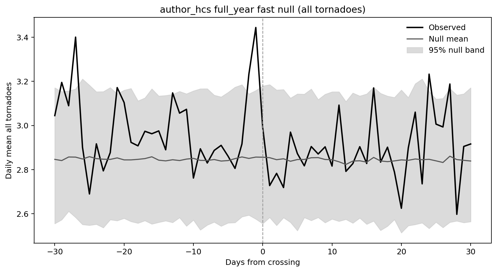
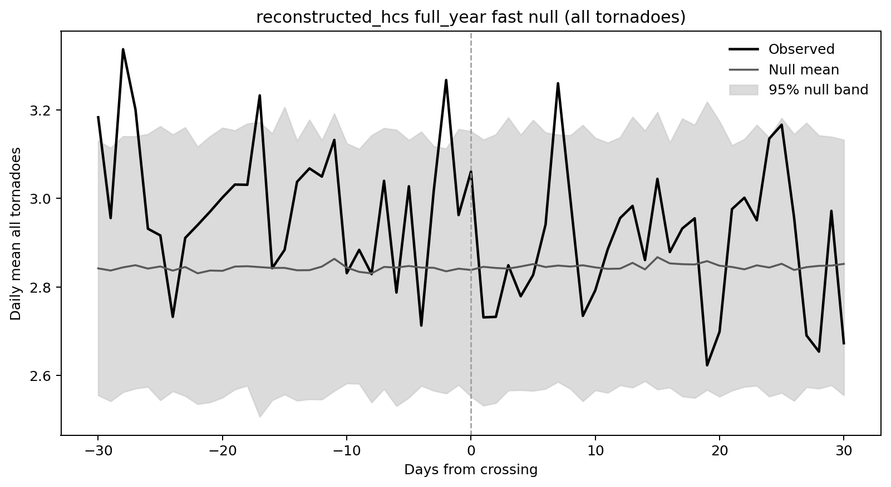
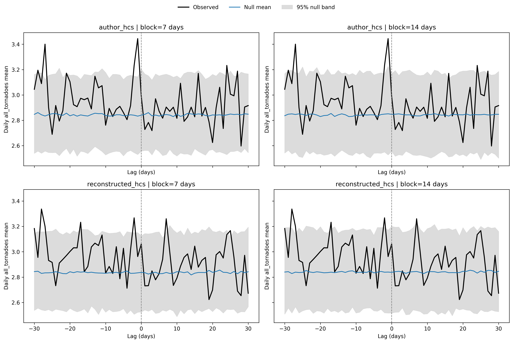

# Tornado occurrence near heliospheric current-sheet crossings: an observational reanalysis of event timing, catalog definitions, and null models

**Article type:** Research article / reproducibility study  
**Running title:** Tornado occurrence and heliospheric current-sheet timing  
**Authors, affiliations, and corresponding author:** To be supplied and approved by the human authors  
**Draft date:** 30 October 2026  
**Analysis period:** 1 January 1963 to 31 December 2023

> **Draft status, not part of the submitted article.** This manuscript incorporates corrected and rerun analyses, including audited source-date repairs, coverage and timing sensitivities, consistent event eligibility, a canonical HCS reconstruction, empirical null-tail probabilities, 50,000-replicate outbreak randomizations, ICME coverage restrictions, and estimated count dispersion. It is suitable for scientific review, not a claim of peer review or causal validation. Authorship, declarations, a frozen public release, and independent scientific review remain necessary before submission; see Appendix B. No WACCM-X simulation or meteorological reanalysis experiment is reported here.

## Abstract

Proposed solar-wind influences on severe weather require tests that distinguish event alignment from seasonality, clustered tornado occurrence, and catalog choices. We reanalyze United States tornado records for 1963-2023 around author-supplied heliospheric current-sheet (HCS) crossing dates and a separate daily magnetic-polarity reconstruction. The analysis includes 22,280 calendar days and 63,258 catalog tornado records. Complete 61-day windows contain 1,788 unique author dates and 1,783 reconstructed dates. At lag 0, mean daily counts are 2.990 and 3.061, respectively, versus full-year random-date null means of 2.856 and 2.838; equal-tail Monte Carlo p-values are 0.387 and 0.152. Seasonal-subset, phase-randomized, and block-resampling comparisons also place lag 0 inside their pointwise null intervals. Corrected lag scans do not reject after adjustment across 16 source/outcome tests. Coverage-screened and documented-UTC daily-count sensitivities also do not reject after separate multiplicity adjustment. Separately, 151 of 457 supplement-derived outbreak starts occur within one day of an author crossing. Under three 50,000-replicate randomization designs, these comparisons remain below 0.05 after Holm adjustment across 87 tests (adjusted p=0.003480-0.010200); their simultaneous Monte Carlo upper bounds are also below 0.05. Unshifted reconstructed-catalog comparisons do not reject (adjusted p=0.234895-0.328633). However, exact sensitivity tests lose the author association when outbreak starts are shifted one day earlier and reject for both catalogs when starts are shifted one day later. The exploratory outbreak association is therefore timing-sensitive, not invariant to daily alignment. These results establish neither equivalence nor solar-wind causation. Independent event ascertainment, meteorological adjustment, and physical diagnostics are needed before stronger attribution or forecasting claims.

**Keywords:** tornadoes; heliospheric current sheet; solar wind; superposed epoch analysis; surrogate data; event coincidence; reproducibility

## 1. Introduction

Tornado occurrence depends on the development and organization of severe convective storms within favorable meteorological environments. Analyses of long records must also contend with changes in observation, reporting, and the temporal concentration of tornadoes. The evolution of the United States tornado database is documented by Verbout et al. (2006), and increased variability and clustering of tornado occurrence are described by Brooks et al. (2014). These features make a count of tornadoes near a proposed external trigger difficult to interpret without an explicit reference distribution.

Prikryl and Rusin (2025) investigated tornado outbreaks in relation to solar-wind disturbances, including heliospheric current-sheet crossings, corotating interaction regions (CIRs), high-speed streams (HSSs), and interplanetary coronal mass ejections (ICMEs). Their proposed mechanism involves magnetosphere-ionosphere coupling and aurorally generated atmospheric gravity waves, potentially contributing to the release of conditional symmetric instability (CSI) in suitable frontal environments. CSI and its diagnosis have a substantial meteorological literature, but the presence of a potentially unstable environment is not itself evidence for a particular external trigger (Schultz and Schumacher, 1999; Chen et al., 2018).

Three questions must be separated. First, do tornado observations align with solar-wind event times more closely than expected under an appropriate null model? Second, is any alignment reproducible under independent event definitions, alternative timing conventions, and controls for meteorological and observational variability? Third, is there evidence for the proposed physical pathway and a dynamically consequential perturbation? The present study addresses parts of the first two questions. It does not measure downward atmospheric wave propagation, diagnose CSI in the observed storms, or simulate storm intensification.

Our objectives are to describe the daily tornado composites, assess the project's designated lag-0 endpoint under several null constructions, and examine the source study's outbreak list without treating its classifications as independent evidence of causation. We also audit the correspondence between the statistical quantities described in reports and those actually computed. This matters because apparently similar labels can refer to different event populations, different null hypotheses, or different mathematical summaries.

The lag-0 endpoint is the current project's primary organizational endpoint, not a prospectively registered hypothesis. Moreover, Prikryl and Rusin (2025) describe a tornado-count peak just before the crossing time, rather than exclusively at lag 0. Consequently, a non-exceptional lag-0 count cannot by itself refute their reported near-crossing pattern. We report the nonzero-lag observations and distinguish their unresolved inferential status from the lag-0 comparisons.

## 2. Data and event definitions

### 2.1. Tornado observations and daily aggregation

The observational series is constructed from the NOAA Storm Prediction Center (SPC) tornado database. The acquired file contains 70,022 rows spanning 1950-2023. One exact duplicate, for 20 June 2015, is removed, leaving 70,021 records. Other repeated year/event identifiers correspond to distinct dates, times, or locations and are retained; identifier equality alone is not used to merge events. The present analysis uses 1963-2023, with daily counts formed by summing retained catalog rows on each recorded calendar date. A complete calendar index is created, and dates without tornado rows receive zero counts. This operation assumes that absence of a catalog entry represents no reported tornado, not missing surveillance.

The resulting series contains 22,280 days and 63,258 tornado records. Secondary outcomes are counts rated at least 3 on the recorded F/EF scale, injuries, and fatalities. There are 2,573 records meeting the rating threshold in the analysis period. Treating F3 and EF3 or greater as a single category is an operational harmonization, not a demonstration that historical rating practices were uniform. An auxiliary daily-model outcome identifies days with at least 10 tornado records; it is distinct from the source paper's category of large outbreaks, defined as at least 20 tornadoes per day.

The primary implementation uses the SPC catalog calendar date without converting each tornado timestamp to UTC. Solar-wind dates are UTC dates. Primary lag therefore measures differences between these date labels rather than a uniform physical elapsed-time interval. The official SPC format specification identifies timezone code 3 as Central Standard Time (fixed UTC-6, not daylight-saving time) and code 0 as GMT. Section 3.7 uses those documented codes for a paired UTC sensitivity; it does not infer a timezone from state or longitude. Of the 63,258 analysis-period records, 63,223 have code 3, six have code 0, 28 have code 6, and one has code 9. The 29 records outside the documented convertible codes are excluded only from the paired timing comparisons. Exact-row duplicates have been audited and removed; remaining records are treated according to the supplied national tornado-file conventions, not as an independently reobserved census.

### 2.2. Solar-wind observations

Hourly OMNI2 data provide interplanetary magnetic-field components, solar-wind speed and proton density, pressure, and geomagnetic quantities. OMNI is a compiled near-Earth solar-wind data product rather than a single homogeneous instrument record (King and Papitashvili, 2005). The parser replaces configured fill-value codes with missing values and computes daily summaries from available observations.

Within 1963-2023, daily mean GSE $B_x$ is available on 19,324 of 22,280 dates, solar-wind speed on 19,355 dates, and proton density on 18,630 dates. The first nonmissing daily $B_x$ in this input is 27 November 1963. Of the nonmissing daily $B_x$ means, 1,694 use fewer than 12 valid hourly values. A nonmissing daily mean does not necessarily represent a complete 24-hour observation: the primary implementation does not impose a minimum hourly-coverage threshold. Section 3.7 reconstructs crossings under 12-, 18-, and 24-hour screens, with low-coverage days acting as hard barriers. These sensitivities assess dependence on measurement availability without establishing that missing exposure observations are ignorable.

### 2.3. Author-supplied HCS catalog

The author catalog is ingested from the locally supplied sector-boundary list. It contains 1,794 parsed rows labeled 1963-2023. Source line 848 specifies the invalid date 1993 November 0, but its day-of-year 304 and elapsed hours 270264 since 1 January 1963 independently agree on 31 October 1993 at 00:00 UTC. We use that internally reconciled timestamp, retaining the original fields, invalid source timestamp, and explicit reconciliation note; no raw source file is modified. Conflicting or unresolved redundant dates cause ingestion to fail rather than being silently dropped. This gives 1,794 valid analysis timestamp rows and 1,792 unique timestamps. Requiring complete intervals from lag -30 to +30 leaves 1,788 unique event dates.

These counts are not interchangeable. The reconciled unique count numerically matches the article's 1,792 crossings, while the ingestion manifest records an author note concerning 1,793. Numerical agreement alone does not establish identical source membership or processing. The fast-null, seasonal, surrogate, and all-lag author analyses consistently use the 1,788 unique complete-window dates.

### 2.4. Daily HCS reconstruction

The main reconstructed catalog uses the sign of daily mean GSE $B_x$. Values with $|B_x|<0.3$ nT are treated as ambiguous. Missing or ambiguous polarity is forward-filled for at most one day. A candidate crossing is the later date of a polarity reversal for which the runs on both sides last at least two days. The spacing filter retains a crossing only if it is more than two days after the previously retained crossing; for daily dates, this implies at least three days of separation.

The full available reconstructed catalog contains 1,865 dates, spanning 3 December 1963 to 14 February 2026. There are 1,786 dates in 1963-2023 and 1,783 after the complete-window restriction. Only the latter population enters the main full-window composites. This is a transparent polarity proxy, not a validated replacement for expert HCS identification. Daily averaging, gap filling, the polarity threshold, and persistence requirements can shift or remove crossings.

An earlier algorithm based on the sign of $-B_xB_y$ has been retired: the product is unchanged when both components reverse sign and therefore cannot uniquely identify opposite sectors. All inferential branches now use the same daily-$B_x$ catalog, and the earlier catalog filename is only a compatibility export of that canonical reconstruction. This repair removes an internal inconsistency, not the need to validate the daily proxy against independent crossing information.

### 2.5. CIR, HSS, and outbreak catalogs

The HSS-onset proxy requires a daily mean speed of at least 500 km s$^{-1}$ and a day-to-day increase of at least 80 km s$^{-1}$. The CIR proxy additionally requires at least one compression indicator: proton density of at least 8 cm$^{-3}$, magnetic-field magnitude of at least 8 nT, or flow pressure of at least 2.5 nPa. These threshold events are not asserted to be a complete expert-classified CIR or HSS catalog.

The exploratory outbreak branch uses 457 entries extracted from Table S1 of Prikryl and Rusin (2025), spanning 29 April 1963 to 13 May 2022. Each entry is anchored on its outbreak start date; a multiday entry is not expanded into independent outbreak starts. Cross-month ranges are recognized before date parsing; the audit restored eight starts previously truncated to their ending dates. The source interval 31 May-24 June 1996 is retained literally with a 31 May anchor. One range, 28 February-1 March 2011, has its year inferred from adjacent dated entries on supplement page 14. Both interpretations were accepted by the project author on 30 October 2026; neither entry is excluded or treated as an unresolved source question. Original text, inference notes, and accepted review status are preserved in an audit table. The earlier seven-day duration screen was a review heuristic, not evidence that a longer interval was invalid and not an outbreak definition. The extraction does not establish an exhaustive, uniformly selected outbreak census.

The major-HSS declining-phase proxy identifies local daily speed maxima of at least 600 km s$^{-1}$, then includes dates one to four days later whose speeds do not exceed the peak. This condition does not require speed to decline monotonically on successive days.

Both outbreak calculations now use the parsed Richardson-Cane catalog (Richardson and Cane, 2010, with subsequent catalog updates), with the corresponding outcome and null calendars restricted to 1 January 1996 onward. There are 293 eligible outbreak starts; the 164 earlier starts are excluded rather than counted as noncoincident or assigned large distances to later events. A separate OMNI-threshold ICME proxy is not substituted for the direct catalog. All event catalogs are restricted to the common analysis calendar before outbreak comparisons.

**Table 1. Analysis populations and coverage.** Counts refer to the indicated stage, not to interchangeable estimates of sample size.

| Product or population | Coverage or restriction | Count |
|---|---|---:|
| Daily analysis calendar | 1963-2023 inclusive | 22,280 days |
| SPC tornado records in analysis | Recorded catalog calendar dates, exact duplicates removed | 63,258 records |
| Strong-tornado records | Recorded F/EF rating at least 3 | 2,573 records |
| Daily mean OMNI GSE $B_x$ | Nonmissing days within analysis calendar | 19,324 days |
| Author HCS parsed rows | Year labels 1963-2023 | 1,794 rows |
| Author HCS valid analysis timestamp rows | One source date reconciled from agreeing redundant fields | 1,794 rows |
| Author HCS unique timestamps | Timestamp duplicates removed | 1,792 timestamps |
| Author HCS main event population | Unique dates, complete -30 to +30-day windows | 1,788 dates |
| Daily $B_x$ HCS reconstruction | Dates in 1963-2023 | 1,786 dates |
| Daily $B_x$ main event population | Complete -30 to +30-day windows | 1,783 dates |
| Supplement-derived outbreaks | Start dates, 1963-2022 | 457 entries |
| ICME outbreak comparison | Starts in documented 1996-onward catalog coverage | 293 entries |

## 3. Statistical methods

### 3.1. Estimands and interpretation of cumulative counts

For daily tornado count $Y_t$, event dates $e_i$, and lag $\ell$, the complete-window composite is

$$
\bar{Y}(\ell)=\frac{1}{N}\sum_{i=1}^{N}Y_{e_i+\ell},
\qquad \ell=-30,\ldots,30.
$$

Here $N$ is constant across lags within a complete-window analysis. Windows can overlap, so the same calendar day can contribute to multiple event windows. The number of crossings is therefore not an independent sample size for standard-error calculations.

The lag-0 contrast against a given null is

$$
\Delta_0=\bar{Y}(0)-\mathbb{E}_{0}\{\bar{Y}^{*}(0)\},
$$

where the expectation is estimated by Monte Carlo averaging. This is an observed-minus-null contrast, not an identified causal effect. Different null constructions give different reference expectations.

The source article describes cumulative tornado numbers *for each epoch day*. Such an accumulation across events is $S(\ell)=\sum_iY_{e_i+\ell}=N\bar{Y}(\ell)$ when the contributing population is fixed. It has the same lag pattern as the daily mean. The corrected paper-style implementation uses these totals. It no longer substitutes a running sum across lags, $C(\ell)=\sum_{k=-30}^{\ell}\bar{Y}(k)$, which cannot reproduce an interior peak for nonnegative counts. We do not argue that dividing across-event totals by $N$ removes a signal. Inferential differences arise from event eligibility, timing, and null construction, not from a simple change of vertical scale.

### 3.2. Full-year and seasonal-subset random dates

The main tabulation uses the deduplicated seasonal-control implementation for both catalogs. It evaluates all calendar months, March-June, and April-June. Within each subset, events are selected by the month of the crossing date, and all events must support a full 61-day window. The lagged outcome dates themselves can extend outside the selected months.

For each catalog-subset combination, 500 null event sets are drawn from eligible dates in the same selected months across the entire analysis period. Sampling is without replacement when the available pool is at least as large as the event population, which applies to the reported subsets. The generator is initialized with seed 42 and advanced through the catalog-subset sequence. The full-year case permits all eligible calendar dates.

These are *seasonal-subset* nulls. They do not preserve the observed number of events in each year, the precise within-season date distribution, or event clustering. They must not be described as year-matched permutations. The separate fast-null implementations sample eligible full-year dates with replacement using the same deduplicated event population; their results are reported separately.

For each lag we report the Monte Carlo mean and the 2.5th and 97.5th percentiles. These are pointwise null intervals for the composite statistic, not confidence intervals for a causal effect or simultaneous bands covering all 61 lags. An excursion at any selected lag is not automatically a familywise-significant discovery.

### 3.3. Phase-randomized and block-resampled outcomes

A phase-randomized sensitivity analysis fixes the unique author crossing dates and randomizes the Fourier phases of the mean-centered daily tornado series. It retains Fourier amplitudes, the mean, and the real-valued constraints on the transform, then computes the event composite for each of 200 surrogates using seed 42. This approach follows the general surrogate-data framework of Theiler et al. (1992).

The phase-randomized series preserves the finite-record power spectrum and corresponding circular autocovariance, but not the empirical count distribution or the original calendar phase of seasonal variation. Surrogates can be noninteger and negative. It is therefore a dependence-oriented sensitivity check, not a realistic generative model of nonnegative, seasonally varying tornado counts.

The block-resampling analysis samples contiguous blocks of observed daily counts with replacement, concatenates them, and truncates the synthetic series to the original record length. Fixed author or daily-$B_x$ event dates are then used to calculate composites. Block lengths are 7 and 14 days, with 500 replicates per catalog-length combination and a generator initialized with seed 42. The construction is related to moving-block resampling for dependent observations (Kunsch, 1989).

This resampling retains observed values and within-block sequences but not the calendar-specific seasonal cycle or all dependence across block boundaries. It is used here as a null-alignment sensitivity analysis, not as an effect-size confidence interval. Agreement among these nulls is informative about lag 0 under their respective assumptions, but is not a substitute for a null that jointly preserves season, reporting era, and relevant serial dependence.

### 3.4. Season- and cluster-aware all-lag calculations

The corrected all-lag branch uses 1,000 randomized event sets. Observed dates are deduplicated and restricted to complete windows. The null shifts each year's entire event pattern by a shared offset of up to 15 days, preserving the number and spacing of events within that year and approximate season. Admissible shifts keep all dates within the same year and the complete-window calendar. This jointly addresses within-year event clustering and seasonal alignment, but not dependence across calendar-year boundaries. Its statistic is the maximum absolute *raw daily mean* across the 61 lags:

$$
T=\max_{\ell}|\bar{Y}(\ell)|.
$$

For nonnegative tornado counts, this is the maximum count mean, not a maximum centered anomaly or a standardized effect. The reported Monte Carlo value is

$$
p_{\mathrm{MC}}=\frac{1+\#\{T_b^{*}\geq T_{\mathrm{obs}}\}}{B+1}.
$$

The maximum accounts for scanning lags within a source-outcome combination. A separate Holm correction covers all 16 combinations of four event sources and four outcomes, not every analysis variant explored in the project. Observed and null populations now use the same complete-window eligibility and the canonical daily-$B_x$ reconstruction. Event counts are 1,788 author HCS dates, 1,783 reconstructed HCS dates, 917 CIR proxies, and 1,224 HSS onsets. The analyses remain retrospective and exploratory rather than prospectively registered confirmation.

### 3.5. Exploratory outbreak proximity and coincidence

For outbreak start dates $o_j$ and an event-date set $\mathcal{E}$, nearest-event distance is

$$
D_j=\min_{e\in\mathcal{E}}|o_j-e|.
$$

Mean and median distances are evaluated for five event families: author HCS, daily-$B_x$ HCS, CIR arrival proxies, ICME events, and major-HSS declining-phase days. Coincidence counts record the number of outbreak starts with at least one event in a specified window; a start is counted only once within each specification.

The coincidence family includes symmetric windows of one, two, and three days for each of the five catalogs, plus four directional specifications. These are outbreaks zero to three days after a CIR arrival, outbreaks zero to three days before a reconstructed HCS crossing, outbreaks zero to three days after an ICME event, and outbreak membership in a major-HSS declining-phase day. In the reconstructed-HCS directional specification, the event is on or after the outbreak start; this is not a test of an outbreak following an HCS crossing.

Three randomization designs are applied, each with 50,000 replicates per event family:

1. **Year-month date reassignment:** the observed number of outbreak starts in each year-month is retained, with dates sampled without replacement when possible. This preserves stratum counts, not the observed spacing of starts.
2. **Within-month cluster rotation:** the observed start-day pattern in each year-month receives a common circular shift. This retains monthly counts and cyclic within-month spacing, not clusters crossing month boundaries.
3. **Within-year seasonal cluster shift:** all outbreak starts in a calendar year receive the same shift of up to 15 days, restricted to offsets that keep every shifted date within that year and the available calendar. This preserves within-year spacing across month boundaries but not clusters spanning years; boundary constraints can reduce the available offsets.

Distance and coincidence calculations share a retained bank of null draws within each event family and null design. Independent deterministic random streams are initialized from seed 20260316, the event-family index, and the null-model index. Cache fingerprints include dates, iteration count, seed, and algorithm version, so incompatible inputs are not silently reused. One-sided Monte Carlo tail probabilities test for smaller distances or larger coincidence counts, with the $+1$ correction (Phipson and Smyth, 2010). Sharing draws makes the distance and coincidence comparisons internally consistent without making the correlated tests independent.

The combined family contains $(5\times2+19)\times3=87$ tests. Holm's sequential adjustment is applied across those 87 values (Holm, 1979), not across every analysis explored in this project. With 50,000 replicates, the minimum adjusted value at the first step is $87/50001=0.001740$, so rejection at 0.05 is attainable. Exact binomial Clopper-Pearson bounds for each simulated exceedance probability use a Bonferroni allocation of 0.05 across all 87 tails; applying the monotone Holm transformation to lower and upper endpoints provides a Monte Carlo uncertainty range for adjusted probabilities. These ranges quantify simulation error, not observational sampling uncertainty or causal-effect confidence intervals.

As an arithmetic cross-check, the six headline one-day HCS coincidence null distributions were also calculated without simulation or project sampling helpers. Year-month reassignment gives hypergeometric stratum distributions; month rotation and annual shifts give distributions obtained by enumerating every permitted offset in each stratum. Convolution over independent strata gives the total-count distributions. All six exact tail probabilities fall within the corresponding simultaneous Monte Carlo bounds. This checks the implemented randomization arithmetic, not the scientific exchangeability or selection assumptions.

### 3.6. Auxiliary models and empirical tail probabilities

The pipeline fits negative-binomial maximum-likelihood models for all and strong tornado counts and a binomial model for days with at least 10 tornadoes. Predictors include annual sine and cosine terms, a linear trend measured in years, and indicators of being within one day of each event family. Dispersion is estimated rather than fixed at $\alpha=1$. Poisson mean fits and residual-based moment estimates initialize the optimization to avoid spurious boundary solutions; convergence and finite uncertainty estimates are required. Count and binomial models use a heteroskedasticity- and autocorrelation-consistent covariance with 14 daily lags. These remain exploratory in-sample fits, without held-out forecast validation or meteorological adjustment.

Lag-0 probabilities are now computed directly from simulated tail counts, not interpolated from percentile endpoints. Upper- and lower-tail values include the $+1$ correction; the two-sided value is twice the smaller tail, capped at one. Generating scripts save these sufficient statistics and the iteration count. The reporting script rejects summary-only inputs lacking empirical tail information rather than inventing a cumulative distribution. These null-tail values supplement the pointwise percentile comparisons.

### 3.7. Measurement-coverage and daily-timing sensitivities

These additional analyses were defined after the primary results were available and remain exploratory. They do not replace the original 16-test lag-scan family or 87-test outbreak family. Both accepted source entries remain in every outbreak variant.

Daily valid-hour counts use nonmissing hourly GSE $B_x$, with duplicate timestamps rejected. The canonical reconstruction is reapplied over the full available OMNI period at minimum daily coverage of 12, 18, and 24 hours, retaining the 0.3 nT ambiguity threshold, two-day side runs, and spacing rule. Days failing the coverage threshold are not allowed to supply a polarity or be forward-filled. Ambiguous values on qualified days retain the original one-day fill rule. A separate one-hour screen isolates the removal of missing-day bridging from the stronger coverage screens. Reconstructing the catalog can change which later dates pass the spacing rule, so screened catalogs need not be strict subsets of the primary catalog.

For timing, we compare the full SPC catalog-date outcome with two paired outcomes: catalog-date counts and UTC-date counts from the same documented-code records. Code 3 timestamps receive six hours; code 0 timestamps are unchanged. All available SPC records are converted before restriction to the analysis calendar, and boundary flows are audited. No record with an unresolved timezone is assigned a guessed offset. We also shift author and primary reconstructed event dates by -1 and +1 day while leaving the catalog-date tornado outcome unchanged; complete-window eligibility is recalculated after shifting.

The six crossing definitions (author, primary reconstruction, and four coverage screens) crossed with three outcome calendars give 18 daily scenarios; four event-shift scenarios give 22 in total. Each uses 10,000 shared annual-shift randomizations of up to 15 days, constrained to remain in-year and preserve complete windows. The lag-0 two-sided endpoint and maximum raw daily mean across all 61 lags give 44 tests, adjusted together by Holm. Equal-tail $+1$ probabilities and integer-total comparisons follow the earlier definitions. This annual-shift reference is different from the full-year random-date null in Table 2; its null means and probabilities should not be interchanged with that table. Simulated totals and all observed curves are retained.

The outbreak sensitivity uses the six crossing definitions at the stated outbreak dates, plus -1/+1-day shifts of outbreak starts against each of the two primary HCS catalogs. These ten variants are evaluated under all three original null designs using exact convolution, giving a separate 30-test Holm family. The outcome denominator remains 457 and the null calendar remains the full analysis calendar. Outbreak shifts are discrete alignment stress tests, not UTC conversions: the source list lacks the event times and timezone information necessary to make such conversions. Coverage screens test the reconstructed HCS exposure, not the completeness of the author-supplied catalog or every other solar-wind variable.

## 4. Results

### 4.1. Lag-0 daily tornado counts

In the deduplicated full-year author analysis, the mean count at lag 0 is 2.989933 tornado records per day, compared with a null mean of 2.856180 and a pointwise 95% null interval of 2.555020-3.178789. The observed-minus-null contrast is 0.133753 records per day, or 4.68% of the null mean. For the daily-$B_x$ reconstruction, the corresponding values are 3.061133, 2.838452, and 2.552776-3.151767; the contrast is 0.222681 records per day, or 7.85% of the null mean. Neither observed count lies outside its pointwise null interval. Direct Monte Carlo equal-tail two-sided p-values are 0.387226 and 0.151697, respectively.

March-June and April-June composites have higher absolute counts, consistent with a different seasonal subset of the daily record. Lag 0 lies within the corresponding null interval for both catalogs in both subsets (Table 2). These results concern the specified same-day comparisons and do not demonstrate that any physically meaningful effect is smaller than a particular threshold.

**Table 2. Lag-0 means under seasonal-subset date randomization.** Units are tornado records per day. All rows use unique event dates, complete windows, and 500 replicates. Intervals are pointwise null percentiles, not effect-size confidence intervals.

| Catalog | Event-date subset | Events | Observed mean | Null mean | Null 2.5% | Null 97.5% |
|---|---|---:|---:|---:|---:|---:|
| Author HCS | Full year | 1,788 | 2.989933 | 2.856180 | 2.555020 | 3.178789 |
| Daily-$B_x$ HCS | Full year | 1,783 | 3.061133 | 2.838452 | 2.552776 | 3.151767 |
| Author HCS | March-June | 608 | 5.355263 | 5.175164 | 4.520518 | 5.940090 |
| Daily-$B_x$ HCS | March-June | 587 | 5.647359 | 5.182201 | 4.559497 | 5.877385 |
| Author HCS | April-June | 470 | 6.378723 | 6.167443 | 5.360479 | 6.986543 |
| Daily-$B_x$ HCS | April-June | 452 | 6.845133 | 6.148248 | 5.253042 | 7.079038 |



**Figure 1. Author-HCS daily tornado composite.** The black curve is the mean daily count across 1,788 unique crossing dates with complete windows. The gray line and shading are the mean and pointwise 2.5th-97.5th percentiles from 500 full-year random-date samples without replacement. The vertical dashed line marks the crossing date. The peak at lag -1 is visible and is not negated by lag 0 lying inside the interval. The shading is not a simultaneous 61-lag confidence band.



**Figure 2. Daily-$B_x$ reconstructed-HCS composite.** The calculation uses 1,783 complete-window dates and the same class of full-year random-date null as Figure 1. This is the daily polarity-reversal catalog, not the earlier product-of-components proxy. The largest observed daily mean is at lag -28. Pointwise excursions do not by themselves establish a lag-scanning-adjusted result.

### 4.2. Dependence-oriented sensitivity analyses

The author lag-0 count also lies inside the phase-randomized interval, with null mean 2.833203 and interval 2.545342-3.154546. All four block-resampling comparisons place lag 0 within their corresponding intervals (Table 3; Figure 3). These outcomes show that the lag-0 observation is not exceptional under the tested alignment models. The seasonal-subset and surrogate checks preserve different properties; the annual cluster-shift analysis separately addresses approximate season and within-year event spacing together.

**Table 3. Lag-0 comparisons using surrogate and block-resampled daily outcomes.** Observed author and daily-$B_x$ means are 2.989933 and 3.061133, respectively. Event populations are 1,788 and 1,783. Units are tornado records per day.

| Catalog | Null construction | Replicates | Null mean | Null 2.5% | Null 97.5% |
|---|---|---:|---:|---:|---:|
| Author HCS | Phase randomized | 200 | 2.833203 | 2.545342 | 3.154546 |
| Author HCS | 7-day blocks | 500 | 2.840331 | 2.556753 | 3.201664 |
| Author HCS | 14-day blocks | 500 | 2.847147 | 2.555467 | 3.166960 |
| Daily-$B_x$ HCS | 7-day blocks | 500 | 2.837317 | 2.525911 | 3.126220 |
| Daily-$B_x$ HCS | 14-day blocks | 500 | 2.837780 | 2.517050 | 3.199720 |



**Figure 3. Block-resampling sensitivity.** Upper panels use author-HCS dates and lower panels daily-$B_x$ dates; columns use 7- and 14-day blocks. Black curves are observed composites, blue curves are null means, and shading gives pointwise 95% null intervals from 500 replicates. Blocks preserve local outcome sequences, but their reassignment does not retain the original seasonal calendar. Nonzero-lag excursions remain visible; no simultaneous-band interpretation is intended.

### 4.3. Nonzero-lag structure under corrected all-lag comparisons

The deduplicated author full-year composite reaches its maximum of 3.444072 tornado records per day at lag -1. The corresponding daily-$B_x$ maximum is 3.337072 at lag -28. The former is qualitatively consistent with the timing of the source paper's reported near-crossing maximum, although this study has not completed an exact reproduction of its data treatment and null calculation.

The corrected all-lag calculation uses the same complete-window author and daily-$B_x$ populations as the primary composites. The author maximum at lag -1 has a lag-scan Monte Carlo p-value of 0.018981 and a Holm-adjusted value of 0.303696 across the 16 source/outcome tests. The CIR all-tornado maximum is 3.681570 at lag -3, with corresponding values of 0.043956 and 0.599401. The reconstructed-HCS and HSS all-tornado values are larger (Table 4). No member of the 16-test family is below 0.05 after Holm adjustment; secondary outcomes are listed in Appendix A.

These are corrected, internally consistent tests under the annual-shift null, not a reconstruction of prospectively specified hypotheses. Their negative adjusted results do not invalidate the visible peaks or establish equivalence, and the 16-test family does not cover every retrospective choice in the project.

**Table 4. Corrected exploratory all-lag outputs for all tornadoes.** The statistic is the maximum raw daily mean across lags -30 to +30; each calculation uses 1,000 annual cluster-shift randomizations. Holm adjustment covers the 16 source/outcome combinations.

| Event source | Maximum daily mean | Lag of maximum, days | Monte Carlo p | Holm p |
|---|---:|---:|---:|---:|
| Author HCS | 3.444072 | -1 | 0.018981 | 0.303696 |
| Daily-$B_x$ HCS | 3.337072 | -28 | 0.293706 | 1.000000 |
| CIR proxy | 3.681570 | -3 | 0.043956 | 0.599401 |
| HSS onset proxy | 3.522059 | -3 | 0.214785 | 1.000000 |

### 4.4. Outbreak-list proximity and classification

Of 457 outbreak start dates, 151 (33.04%) are within one day of an author-HCS date. Expected counts under the three null designs range from 116.040 to 116.983 (25.39%-25.60%). This represents a descriptive excess of approximately 34-35 outbreak starts, not an estimate of the number caused by solar-wind forcing.

Among 50,000 simulations, the observed author count is reached or exceeded 3 times under year-month reassignment, 5 times under month rotation, and once under annual shifts. Add-one nominal p-values are 0.000080, 0.000120, and 0.000040, respectively. All three comparisons remain below 0.05 after Holm adjustment across the full 87-test family. Their simultaneous Monte Carlo upper bounds also remain below 0.05 (Table 5). These are three sensitivities of the same observational finding, not three independent replications.

**Table 5. Exploratory coincidence within one day of HCS crossings.** The denominator is 457 outbreak starts and each null uses 50,000 replicates. Probabilities are one-sided Monte Carlo values. The last column gives Holm-transformed simultaneous Monte Carlo bounds, accounting for simulation uncertainty across 87 tests, not observational effect-size uncertainty.

| Catalog | Null design | Observed starts | Null mean starts | Nominal p | Holm p | Holm Monte Carlo bounds |
|---|---|---:|---:|---:|---:|---|
| Author HCS | Year-month reassignment | 151 | 116.982860 | 0.000080 | 0.006880 | 0.000213-0.025147 |
| Author HCS | Month rotation | 151 | 116.878280 | 0.000120 | 0.010200 | 0.000951-0.030871 |
| Author HCS | Within-year shift, up to 15 days | 151 | 116.039600 | 0.000040 | 0.003480 | 0.000001-0.018453 |
| Daily-$B_x$ HCS | Year-month reassignment | 141 | 117.308480 | 0.004160 | 0.328633 | 0.254563-0.412642 |
| Daily-$B_x$ HCS | Month rotation | 141 | 117.260960 | 0.002900 | 0.234895 | 0.172199-0.307846 |
| Daily-$B_x$ HCS | Within-year shift, up to 15 days | 141 | 116.736460 | 0.003880 | 0.310394 | 0.238097-0.392767 |

Across all 87 tests, four adjusted estimates are at or below 0.05. Three are the author-HCS one-day comparisons in Table 5. The fourth is the author-HCS two-day comparison under annual shifts: 221 observed starts versus a null mean of 188.493500, adjusted p=0.028559. Its Monte Carlo range, 0.009554-0.058616, spans 0.05, so that threshold decision remains simulation-sensitive. The author-HCS two-day month-rotation comparison also has a range spanning 0.05, although its adjusted estimate is 0.063079. The year-month two-day comparison has both its adjusted estimate and Monte Carlo lower bound above 0.05. No remaining test has an adjusted estimate below 0.05.

The earlier 1,000-replicate run could not attain a first-step Holm value below 0.05 because $87/1001=0.086913$. The corrected 50,000-replicate run removes that computational barrier; the conclusion must change with the improved evidence rather than preserving the earlier absence of adjusted rejections. Neither multiplicity correction nor greater simulation precision removes retrospective choices, shared-source selection, or meteorological confounding.

The supplement-derived author labels comprise 139 Type A, 147 Type B, 46 Type C, and 84 Type D entries, with 41 unknown labels. A rule-based reclassification agrees exactly on 94 of 457 entries (20.57%), with 273 entries left unclassified. This is not a classification-accuracy estimate: the independent rules use different thresholds, available data, and precedence decisions, and neither label set is established ground truth. The comparison indicates sensitivity to operational definitions rather than proving that the source labels are incorrect.

Both ICME calculations now use the same direct catalog and exclude 164 pre-1996 outbreak starts, leaving 293 covered starts. The corresponding independent-null one-day coincidence count is 42 versus a null mean of approximately 42.70; no ICME distance or coincidence test rejects after Holm adjustment. This coverage-restricted result does not imply anything about unobserved ICMEs before 1996.

### 4.5. Coverage and daily-timing sensitivity results

The stricter coverage requirements reduce available analysis days from 19,324 with any measured $B_x$ to 17,630, 16,090, and 13,206 at 12, 18, and 24 valid hours. Their complete-window reconstructed populations are 1,423, 1,284, and 1,054, compared with 1,783 in the primary reconstruction. Even the one-hour hard-barrier variant retains only 1,662 complete-window dates, demonstrating that the original allowance for a single missing day affects event ascertainment. Three or four screened crossing dates are newly retained relative to the primary catalog at each of the stricter thresholds because the spacing filter is reapplied.

**Table 6. Reconstructed-HCS coverage and UTC sensitivities.** The one-hour screen prevents bridging of wholly unobserved days. All screened variants forbid filling on days below the specified threshold. Catalog-date columns use all records; UTC columns exclude the 29 unresolved-code records. Paired catalog-date controls using exactly the UTC population and full null curves are saved separately. The two displayed probabilities are nominal lag-0 two-sided values under 10,000 annual cluster shifts, not the Table 2 null. No lag-0 or maximum-raw-count test in the 44-test daily sensitivity family rejects after Holm adjustment.

| Crossing definition | Qualified days | Complete-window events | Catalog-date lag-0 mean | UTC lag-0 mean | Catalog-date p | UTC p |
|---|---:|---:|---:|---:|---:|---:|
| Primary reconstruction | 19,324 | 1,783 | 3.061133 | 3.024117 | 0.325367 | 0.622138 |
| At least 1 hour, hard barrier | 19,324 | 1,662 | 3.157040 | 3.118532 | 0.188381 | 0.365963 |
| At least 12 hours | 17,630 | 1,423 | 3.226283 | 3.149684 | 0.422358 | 0.889911 |
| At least 18 hours | 16,090 | 1,284 | 3.253894 | 3.165109 | 0.633937 | 0.827517 |
| At least 24 hours | 13,206 | 1,054 | 3.427894 | 3.355787 | 0.718528 | 0.918708 |

Documented conversion moves 20,980 analysis-period tornado records to the following calendar date; no converted records enter or leave the analysis interval. There are 63,229 records in the paired documented-code population. For author HCS, the paired catalog-date lag-0 mean is 2.989374, compared with 3.062081 after UTC aggregation. The author maximum remains at lag -1 but changes from 3.443512 to 3.475391; its nominal lag-scan probability changes from 0.019398 to 0.003900, while the latter is 0.167683 after the 44-test sensitivity correction. Thus the timing convention affects the curve and nominal evidence even though no adjusted daily test rejects. Advancing author event dates one day earlier puts the original lag -1 peak at lag 0, with nominal p=0.003400 but sensitivity-family adjusted p=0.149585. Across all 44 sensitivity endpoints, the smallest adjusted estimate is 0.149585.

Coverage screens also change outbreak proximity (Table 7). The unshifted reconstructed count falls from 141 to 120, 113, and 102 at 12, 18, and 24 hours. Those comparisons do not reject after the separate 30-test correction. These are different observed exposure sets, not evidence that removing low-coverage dates estimates a causal attenuation.

**Table 7. Exact one-day outbreak coincidence sensitivities.** All rows retain 457 source-list entries. Null means and adjusted p ranges span the three original null designs. Holm adjustment covers these ten variants times three nulls (30 tests), not the original 87-test family in Table 5. A start shift of +1 means the source start date is moved one calendar day later while HCS dates remain fixed.

| Crossing definition | Outbreak-start shift, days | Observed starts | Exact null mean range | Sensitivity Holm p range |
|---|---:|---:|---|---|
| Author HCS | 0 | 151 | 116.044478-116.966781 | 0.001049-0.002544 |
| Primary reconstruction | 0 | 141 | 116.770363-117.310480 | 0.067336-0.070195 |
| At least 1 hour, hard barrier | 0 | 136 | 111.954333-112.497961 | 0.064769-0.068141 |
| At least 12 hours | 0 | 120 | 104.383291-104.536210 | 0.445630-0.476066 |
| At least 18 hours | 0 | 113 | 98.295945-98.405872 | 0.476066-0.476066 |
| At least 24 hours | 0 | 102 | 88.827364-89.514474 | 0.476066-0.476066 |
| Author HCS | -1 | 121 | 115.786622-116.425075 | 1.000000-1.000000 |
| Author HCS | +1 | 161 | 116.291058-117.123648 | 0.000008-0.000026 |
| Primary reconstruction | -1 | 119 | 116.340663-116.699650 | 1.000000-1.000000 |
| Primary reconstruction | +1 | 148 | 116.821907-117.168502 | 0.005222-0.007132 |

The author association is therefore not invariant to one-day shifts: moving starts one day earlier removes the enrichment, while moving them one day later strengthens it and also yields adjusted rejection for the primary reconstructed catalog. This does not identify which daily alignment is physically correct. It means the unshifted result's catalog dependence and strength cannot be generalized across timing conventions. Exact tail calculation removes simulation uncertainty from these 30 tests, not observational, selection, or timing uncertainty.

## 5. Discussion

### 5.1. What the comparisons establish

The most directly supported finding is narrow: the lag-0 mean daily tornado count is inside the implemented pointwise null intervals for both author and daily-$B_x$ dates, including the seasonal and dependence-oriented sensitivity comparisons. The result is reproducible from the saved daily series, event catalogs, and null construction. It does not establish a zero effect, statistical equivalence, or an upper bound on a physically relevant perturbation. No equivalence margin or power analysis was specified.

The visible lag -1 peak and the outbreak-proximity enrichment must be considered separately. The lag -1 peak is relevant to the original paper's near-crossing observation, while the outbreak statistic changes the sampling unit from tornado counts on all calendar days to starts in a selected outbreak list. A result for one does not logically determine the other. The computational audit now provides corrected eligibility for the all-lag calculation and higher-resolution adjusted outbreak tests. Interpretation must still respect their different estimands and retrospective sampling, rather than selecting whichever result gives a preferred conclusion.

This distinction also changes how replication should be discussed. An across-event sum and a mean have identical shapes when event counts are constant. Calling the original figure a cumulative curve does not establish an accumulation artifact across lags. The appropriate scrutiny is of its event selection, time alignment, uncertainty definition, and multiplicity. The source paper used 100 random-key-time repetitions and displayed a mean plus or minus a standard deviation for its comparison; the present percentile intervals are not the same uncertainty summary.

The improved unshifted outbreak calculation provides positive evidence of proximity under the implemented nulls for the author catalog, while the analogous reconstructed-catalog tests do not reject. The one-day shifts qualify that contrast: advancing outbreak starts one day later produces adjusted rejection for both primary HCS catalogs, whereas shifting them earlier removes both associations. Catalog choice, ascertainment, and timing are therefore central, not incidental, to interpretation. The outbreak list and author crossings come from the same research context; conditioning on the supplied list cannot rule out selection processes that helped create it. Holm adjustment covers the declared families, not every historical choice of catalog, list, timing window, or endpoint. A separately ascertained outbreak population and independent crossing validation would be more discriminating than further precision on this same selected sample alone.

### 5.2. Null-model assumptions and temporal structure

None of the implemented sensitivities simultaneously preserves all important properties of the observational record. Full-year random dates lose year and seasonal matching. Seasonal-subset random dates restrict months but still mix reporting eras and event-density variations. Phase randomization preserves spectral amplitudes but changes seasonal phase and the count distribution. Moving blocks preserve short-range sequences but reassign their calendar positions. Independently reassigned outbreak dates preserve year-month counts but lose clustering, while cluster shifts retain particular spacing structures with boundary limitations.

Consequently, agreement among lag-0 comparisons should not be described as exhaustive control of confounding. A stronger design would define the exposure and outcome without using the final evaluation set, preserve or condition on season and reporting era, and explicitly model dependence and available solar-wind observations. The documented-UTC and coverage-screen analyses test specific observational choices, not all missingness or timing mechanisms. Their substantial changes to crossing populations and nominal daily evidence, together with the outbreak shift results, show why daily alignment must be justified rather than selected for a favorable p-value.

The outbreak-list analysis has an additional selection issue. Conditioning on a list assembled for interpreting outbreaks in solar-wind context does not establish that list membership is independent of event proximity. Even an accurately computed small p-value would apply to the specified randomization of this list, not automatically to all tornado outbreaks. A prospectively specified meteorological outbreak definition, applied uniformly to the tornado record without viewing solar-wind data, would provide a stronger independent test.

### 5.3. From timing association to physical attribution

HCS crossings, CIR arrivals, HSS speed changes, and geomagnetic disturbances describe different stages or features of solar-wind interaction. They should not be treated as interchangeable timestamps for a single causal exposure. An HCS date is not itself a measurement of auroral heating or the launch of a gravity-wave packet. A before-crossing tornado peak cannot be interpreted causally without establishing the relevant forcing time and propagation delay.

The proposed mechanism also requires an atmosphere capable of responding to the perturbation. Diagnosing CSI or slantwise convective potential is not equivalent to demonstrating that auroral forcing triggered its release, and release of CSI is not itself a direct tornado-production mechanism. Meteorological controls for instability, moisture, shear, frontal structure, and the parent cyclone would be necessary to isolate a candidate external contribution (Schultz and Schumacher, 1999; Chen et al., 2018).

A future modeling program could combine meteorological reanalysis with whole-atmosphere simulations, including WACCM-X, and higher-resolution storm-environment experiments where justified. Its discriminating measurements would include wave-energy propagation direction, amplitude and attenuation, arrival time, and sensitivity of a diagnosed unstable environment to perturbations of that magnitude. Paired forcing experiments and suitable ensembles would be needed to distinguish a forced response from internal variability. These are proposed next steps, not results of the present study.

### 5.4. Limits on forecasting and interpretation

No out-of-sample forecasting experiment is reported. The auxiliary regression fits are in-sample, use a simple seasonal representation, and do not establish incremental predictive skill over meteorological baselines. The fitted negative-binomial dispersion is approximately 2.984 for baseline all-tornado counts and 2.981 after adding event indicators, compared with 15.599 and 15.447 for strong-tornado counts. These estimates replace the unjustified fixed value of one, but do not validate the full model specification. Accordingly, the present findings do not justify adding solar-wind variables to operational tornado forecasts, nor do they show that such variables can never be useful.

The additional coverage and timing tests do not establish invariance to all observation conventions. They address hourly completeness of reconstructed $B_x$ crossings and documented SPC date conversion, not the completeness of the author catalog, CIR/HSS/ICME exposure measurements, or historical reporting. Holding the full null calendar fixed while screening observed crossings also leaves a measurement-availability assumption. The selected outbreak list cannot be converted to UTC from its date ranges alone. The 1996 interval and inferred 2011 year are accepted source interpretations, not pending exclusion tests.

Likewise, inability to distinguish lag 0 from particular null distributions is not a general disproof of Sun-atmosphere coupling. Conversely, exploratory temporal alignment is not evidence for the full magnetosphere-ionosphere-atmosphere pathway. The appropriate conclusion concerns what these data and implementations currently establish, with unresolved tests clearly identified.

## 6. Conclusions

This observational reanalysis separates complete-window daily tornado composites from exploratory lag scans and outbreak-list coincidence tests. In 1963-2023, the author and daily-$B_x$ HCS catalogs give lag-0 mean daily counts within all reported pointwise null intervals. The positive observed-minus-null contrasts are descriptive and do not establish a causal effect or statistical equivalence.

The corrected all-lag family does not reject after adjustment across 16 source/outcome tests. No daily-count test rejects in the separate 44-test coverage/timing sensitivity family either. In contrast, unshifted outbreak starts within one day of author-HCS dates show exploratory enrichment after adjustment across 87 tests under all three null designs, with simultaneous Monte Carlo upper bounds below 0.05. The corresponding unshifted reconstructed-catalog tests do not reject. However, the exact 30-test sensitivity family loses the author association for one-day-earlier outbreak starts and rejects for both catalogs for one-day-later starts. The association is therefore alignment-sensitive. These outcomes must not be collapsed into either a blanket null conclusion or a causal claim.

The immediate scientific priorities are independent event ascertainment, external validation of crossing dates and coverage, justified physical timing, and meteorological controls. Held-out evaluation is necessary before any forecasting claim; direct physical diagnostics are necessary to assess the proposed storm-intensification mechanism. The computational defects identified in this audit have been repaired and bounded observation sensitivities have been evaluated, but retrospective associations cannot by themselves confirm or refute the broader physical hypothesis.

## Data and code availability

The project repository is [EmilAP/solar-weather-reanalysis](https://github.com/EmilAP/solar-weather-reanalysis). Public tornado inputs originate from [NOAA SPC](https://www.spc.noaa.gov/wcm/); solar-wind inputs originate from [NASA OMNIWeb](https://omniweb.gsfc.nasa.gov/). The source article and its supplement are available through Prikryl and Rusin (2025). Availability and redistribution permission for the locally supplied sector-boundary list must be confirmed before a reproducibility release.

The manuscript uses local CSV products listed in Appendix C. The recorded workspace publication run, `20261030T204923Z`, reports successful completion of all 38 steps, including the observation sensitivities, without network acquisition. Before the new sensitivities, isolated baseline run `20261030T194840Z` completed the then-37-step workflow starting with source scripts, configuration, and raw inputs but no derived products or null caches. Its later output comparison is described in Appendix C. The expanded workflow reuses signature-compatible primary outbreak simulation banks; its eight new sensitivity CSV/JSON/draw products reproduced byte-for-byte between standalone execution and the integrated run. The new sensitivity script has no cache dependency. All runs used the same installed virtual environment, not independently installed dependencies. Retained outbreak null draws are stored in family-specific compressed NumPy files in `data/derived/spe/`; input signatures prevent reuse for different event populations. A successful process run is not a scientific validation of every output. The working tree includes unpublished changes, and a released code version, environment specification, data-access record, and immutable result archive must be established before submission. No archival DOI is claimed.

With the acquisition inputs already staged, the existing workflow is invoked from the repository root with:

```bash
.venv/bin/python scripts/run_publication.py
```

This reproduces the corrected computational workflow from staged local inputs; it does not remove residual observational or causal limitations. The optional paper-style random-date Monte Carlo calculation (`scripts/16_reproduce_paper_hcs_spe.py --run-null`) is not part of the default run. Its statistics are now totals across events at each epoch day, not running sums over lags, but exact replication of the source study's input and uncertainty conventions is not claimed.

## Author contributions

To be completed by the authors using the target journal's contribution taxonomy. Authorship, contribution assignments, author order, affiliations, and approval of the final manuscript have not been inferred from repository ownership or from the authorship of the source article.

## Competing interests and relevant relationships

To be declared by the authors. This declaration should address any relevant familial or collaborative relationship with the authors of the study being reanalyzed, as well as financial and nonfinancial interests. No declaration of absence of competing interests is assumed in this draft.

## Funding

To be confirmed by the authors. No grant, institutional support, or computing allocation is claimed on the basis of the current project files.

## Acknowledgments

We acknowledge the providers of the SPC and OMNI data products and the source article and supplement used to define the reanalysis. Any acknowledgment of direct data provision or collaboration must be confirmed with the relevant individuals before submission.

## Use of AI-assisted tools

An AI assistant using Copilot SDK in VS Code assisted with inspection of project code and outputs, identification of methodological inconsistencies, and preparation of this draft. The human authors remain responsible for verifying the analyses, references, interpretation, originality, and final wording. This disclosure should be adapted to the target journal's policy; AI assistance does not constitute authorship or independent scientific validation.

## References

Brooks, H. E., Carbin, G. W., and Marsh, P. T. (2014). Increased variability of tornado occurrence in the United States. *Science*, **346**, 349-352. https://doi.org/10.1126/science.1257460

Chen, T.-C., Yau, M. K., and Kirshbaum, D. J. (2018). Assessment of conditional symmetric instability from global reanalysis data. *Journal of the Atmospheric Sciences*, **75**, 2425-2443. https://doi.org/10.1175/JAS-D-17-0221.1

Holm, S. (1979). A simple sequentially rejective multiple test procedure. *Scandinavian Journal of Statistics*, **6**(2), 65-70. https://www.jstor.org/stable/4615733

King, J. H., and Papitashvili, N. E. (2005). Solar wind spatial scales in and comparisons of hourly Wind and ACE plasma and magnetic field data. *Journal of Geophysical Research: Space Physics*, **110**, A02104. https://doi.org/10.1029/2004JA010649

Kunsch, H. R. (1989). The jackknife and the bootstrap for general stationary observations. *The Annals of Statistics*, **17**(3), 1217-1241. https://doi.org/10.1214/aos/1176347265

NOAA Storm Prediction Center (2010). *SPC Tornado, Hail, and Wind Database Format Specification (for .csv output)*, updated 7 April 2010, field 7, p. 1. https://www.spc.noaa.gov/wcm/data/SPC_severe_database_description.pdf (accessed 30 October 2026).

Phipson, B., and Smyth, G. K. (2010). Permutation p-values should never be zero: Calculating exact p-values when permutations are randomly drawn. *Statistical Applications in Genetics and Molecular Biology*, **9**(1). https://doi.org/10.2202/1544-6115.1585

Prikryl, P., and Rusin, V. (2025). Occurrence of tornado outbreaks influenced by solar wind-magnetosphere-ionosphere-atmosphere coupling. *Advances in Science and Research*, **22**, 19-38. https://doi.org/10.5194/asr-22-19-2025. Supplement: https://doi.org/10.5194/asr-22-19-2025-supplement

Richardson, I. G., and Cane, H. V. (2010). Near-Earth interplanetary coronal mass ejections during solar cycle 23 (1996-2009): Catalog and summary of properties. *Solar Physics*, **264**, 189-237. https://doi.org/10.1007/s11207-010-9568-6

Schultz, D. M., and Schumacher, P. N. (1999). The use and misuse of conditional symmetric instability. *Monthly Weather Review*, **127**, 2709-2732. https://doi.org/10.1175/1520-0493(1999)127%3C2709:TUAMOC%3E2.0.CO;2

Theiler, J., Eubank, S., Longtin, A., Galdrikian, B., and Farmer, J. D. (1992). Testing for nonlinearity in time series: The method of surrogate data. *Physica D: Nonlinear Phenomena*, **58**, 77-94. https://doi.org/10.1016/0167-2789(92)90102-S

Verbout, S. M., Brooks, H. E., Leslie, L. M., and Schultz, D. M. (2006). Evolution of the U.S. tornado database: 1954-2003. *Weather and Forecasting*, **21**, 86-93. https://doi.org/10.1175/WAF910.1

## Appendix A. Additional nulls and outcome comparisons

The separate fast-null outputs sample complete-window dates with replacement over the full calendar. Both now use the same unique event populations as Table 2. Their null sampling design and Monte Carlo sequences differ from the seasonal-control implementation.

**Table A1. Full-year fast-null lag-0 outputs with replacement.** Both rows use 500 replicates and unique complete-window dates.

| Catalog | Complete-window population | Observed mean | Null mean | Null 2.5% | Null 97.5% |
|---|---:|---:|---:|---:|---:|
| Author HCS | 1,788 dates | 2.989933 | 2.847025 | 2.539304 | 3.139723 |
| Daily-$B_x$ HCS | 1,783 dates | 3.061133 | 2.847564 | 2.548233 | 3.151739 |

Catalog comparison figures and summaries now restrict both catalogs to unique daily dates in 1963-2023: 1,792 author dates and 1,786 reconstructed dates. Median spacings are 11 and 10 days, respectively, and the median nearest author-to-reconstructed difference is one day. The unrestricted source files still extend through 2024 for author dates and early 2026 for OMNI, but these later dates are not mixed into the comparison. Nearest-date proximity remains a descriptive timing measure, not a one-to-one crossing-validation score.

The secondary-outcome all-lag outputs use the same corrected populations and annual cluster shifts as Table 4.

**Table A2. Corrected all-lag outputs for secondary outcomes.** Units of the maximum are the corresponding mean daily counts. Holm adjustment covers these rows and the four all-tornado rows in Table 4.

| Event source | Outcome | Maximum mean | Lag, days | Monte Carlo p | Holm p |
|---|---|---:|---:|---:|---:|
| Author HCS | Strong tornadoes | 0.181767 | -29 | 0.070929 | 0.851149 |
| Author HCS | Injuries | 7.956376 | -29 | 0.241758 | 1.000000 |
| Author HCS | Fatalities | 0.545861 | -29 | 0.128871 | 1.000000 |
| Daily-$B_x$ HCS | Strong tornadoes | 0.168256 | -2 | 0.211788 | 1.000000 |
| Daily-$B_x$ HCS | Injuries | 7.270892 | 15 | 0.420579 | 1.000000 |
| Daily-$B_x$ HCS | Fatalities | 0.498037 | 15 | 0.219780 | 1.000000 |
| CIR proxy | Strong tornadoes | 0.222465 | -3 | 0.381618 | 1.000000 |
| CIR proxy | Injuries | 14.016358 | -3 | 0.039960 | 0.599401 |
| CIR proxy | Fatalities | 0.930207 | -3 | 0.039960 | 0.599401 |
| HSS onset proxy | Strong tornadoes | 0.187092 | -3 | 0.645355 | 1.000000 |
| HSS onset proxy | Injuries | 11.218954 | -3 | 0.105894 | 1.000000 |
| HSS onset proxy | Fatalities | 0.741830 | -3 | 0.126873 | 1.000000 |

## Appendix B. Author-confirmation and submission checklist

This appendix is an editorial record for completing the draft, not a claim that the listed work has been performed.

1. **Confirm authorship and disclosures.** Supply the author list, affiliations, correspondence, contribution statements, relevant relationships, funding, and approval. Select a target journal and adapt its formatting and AI-use disclosure requirements.
2. **Freeze the analysis hierarchy.** State explicitly that the current analyses are retrospective. Define the endpoints, lag ranges, event catalogs, and multiplicity families for a documented rerun before examining new results. Do not describe that rerun as prospective registration of already observed findings.
3. **Independently review corrected all-lag inference.** Complete-window populations and shared annual shifts are now implemented consistently, and the 16 source/outcome tests receive Holm adjustment. Review the scientific adequacy of the annual-shift null and the maximum-raw-count estimand rather than describing the old eligibility defect as still present.
4. **Validate the HCS proxy externally.** The product-of-components identifier is retired and inferential branches use a canonical reconstruction. Independent validation of thresholds, coverage, and timing against expert crossing information remains a scientific task.
5. **Respect simulation uncertainty.** The 87-test family is rerun at 50,000 replicates with retained draws and Monte Carlo bounds. If bounds straddle a decision threshold, report that uncertainty; any further precision increase should apply to a declared analysis, not a selectively reduced family.
6. **Review coverage assumptions.** Distance and coincidence now use the same direct ICME catalog and exclude pre-1996 starts. Independently confirm the catalog's documented observation interval and the coverage properties of other exposure products.
7. **Interpret the completed observation sensitivities.** Minimum daily $B_x$ coverage, missing-day barriers, documented SPC UTC conversion, and one-day timing shifts are now evaluated in Section 4.5. Both source interpretations have been accepted; no exclusion sensitivity is required. Review the scientific adequacy of the remaining exposure-availability and physical-timing assumptions, rather than describing these computational checks as unperformed.
8. **Strengthen confounding control.** The annual-shift null jointly preserves approximate season and within-year event spacing, but not every relevant property. Consider an independently defined outbreak census, measurement-availability controls, and meteorological covariates. Do not infer causality from randomized dates alone.
9. **Keep model claims limited.** Empirical tail calculations replace interpolated p-values; count dispersion is estimated and serial-dependence-aware covariance is used. Held-out forecasting is necessary only if predictive-skill claims are added; no such claim is made here.
10. **Preserve exact replication distinctions.** Per-epoch-day totals are now correctly computed. Independent source-code and input reconciliation, including the original uncertainty convention, remains necessary before asserting exact replication.
11. **Release reproducible materials.** Record immutable code and input versions, document permissions for the author list, and deposit the shareable outputs. Verify that the manuscript refers to that release rather than an evolving working tree.

## Appendix C. Evidence and reproduction map

The following paths identify the evidence used for this draft. CSV values, not rounded prose in generated reports, supply the numerical tables. Existing files are not silently rewritten to agree with this manuscript.

**Draft verification record.** The source audit independently checked SPC aggregation and OMNI daily products before the source-date repairs. Comparing the old and corrected catalogs confirmed that only the eight audited outbreak starts and the single invalid author timestamp changed; raw row text, original date fields, and outbreak ending dates were preserved. After regeneration, separate arithmetic code, without the project's calculation or sampling helpers, reconstructed all 61 lags of the 16 source/outcome observed curves and checked all 16 lag-scan probabilities against retained permutation curves. It independently recomputed all 87 outbreak observations, tail counts, binomial simulation bounds, and Holm adjustments. Exact convolution verified the six headline coincidence tails against their simultaneous Monte Carlo bounds. These are computational cross-checks, not external scientific review or validation of the observational assumptions.

Before adding the observation sensitivities, 44 regression tests passed, including the eight cross-month extraction patterns, guarded author-date reconciliation, source-review retention, missing declining-phase reconstruction, consistent CIR provenance, and absent report-directory handling, alongside the earlier inference tests. That baseline's cache-free isolated workflow and workspace workflow each completed all 37 steps. Its output-comparison run staged only raw inputs and the five freshly generated simulation banks: 92 CSV products had exactly equal parsed values after normalizing isolated root paths, and all five cache signatures and draw arrays matched exactly. The figure inventory additionally matched every clean-generated row but listed three pre-existing workspace-only figures; those ancillary inventory rows were documented, not deleted or treated as scientific discrepancies. Fingerprints confirmed that the 178 staged source/configuration/input files were unchanged during that baseline check. This is a historical clean-output reproduction check, not a claim that the expanded workflow was independently installed or rerun cache-free.

The expanded 38-step workflow completed successfully in run `20261030T204923Z`, with 56 passing regression tests, including hard coverage barriers, unchanged canonical reconstruction, documented fixed-CST/GMT conversion, unresolved timezone handling, year-boundary rollover, exact small-sample null distributions, integer ties, and annual-shift eligibility. Separate arithmetic checks read raw SPC and OMNI inputs, independently reconstructed all four screened crossing catalogs, checked all 61 observed lags and retained null summaries for the 22 scenarios, recomputed all 44 daily probabilities and their Holm adjustment, and independently convolved all 30 outbreak null distributions. These checks do not use the new sensitivity script's calculation helpers. All eight new sensitivity CSV/JSON/draw products reproduced byte-for-byte between standalone execution and the integrated workflow. The original 16 lag scans and 87 outbreak tests were independently rechecked after the integrated run. Both accepted source entries remain in all outbreak variants.

Numerical cells in Tables 2-7 and A1-A2 were checked against regenerated CSV sources at the displayed precision, together with key prose statistics, classification agreement, model dispersion, the workflow identifier, and local manuscript links. Remaining scientific and submission tasks are listed in Appendix B.

| Manuscript component | Numerical or documentary evidence | Generating implementation |
|---|---|---|
| Daily counts and coverage, Table 1 | [Daily analysis table](../data/derived/daily/analysis_daily.csv); [OMNI daily table](../data/derived/daily/omni_daily.csv) | [SPC parsing](../scripts/12_parse_spc_tornado.py), [OMNI parsing](../scripts/13_parse_omni.py), [daily series](../scripts/15_build_daily_tornado_series.py) |
| Author event populations | [Author HCS catalog](../data/derived/catalogs/author_hcs_catalog.csv); [count reconciliation](../data/derived/tables/author_hcs_count_reconciliation.csv) | [Ingestion](../scripts/11_ingest_author_hcs.py); [reconciliation](../scripts/35_reconcile_author_hcs_counts.py) |
| Main reconstructed population | [Daily-polarity HCS catalog](../data/derived/catalogs/hcs_from_omni.csv) | [Daily reconstruction](../scripts/26_reconstruct_hcs_from_omni.py) |
| Table 2; Figures 1-2 | [Seasonal summary](../data/derived/tables/seasonal_control_summary.csv); [author full-year curve](../data/derived/spe/author_hcs_full_year_fast_null_all_tornadoes.csv); [reconstructed full-year curve](../data/derived/spe/reconstructed_hcs_full_year_fast_null_all_tornadoes.csv) | [Seasonal-control event studies](../scripts/28_seasonal_control_event_studies.py) |
| Table 3, phase surrogate | [Phase-randomized curve](../data/derived/spe/phase_randomized_author_hcs_all_tornadoes.csv) | [Phase-randomized null](../scripts/29_phase_randomized_null_test.py) |
| Table 3; Figure 3 | [Block-resampling summary](../data/derived/tables/block_bootstrap_summary.csv) | [Block-resampling null](../scripts/37_block_bootstrap_null_test.py) |
| Tables 4 and A2 | [All-lag summary](../data/derived/spe/strict_event_study_summary.csv); [author observed curve](../data/derived/spe/author_hcs_strict_observed.csv) | [Corrected all-lag study](../scripts/19_run_stricter_event_study.py); [canonical catalog compatibility export](../scripts/17_build_independent_hcs_from_omni.py) |
| Table 5 and 87-test family | [Combined outbreak test table](../data/derived/tables/author_outbreak_branch_key_results.csv); [distance summary](../data/derived/tables/author_outbreak_event_distance_null_summary.csv); [coincidence summary](../data/derived/tables/author_outbreak_event_coincidence_summary.csv) | [Distance tests](../scripts/43_author_outbreak_event_distance_test.py), [coincidence tests](../scripts/44_author_outbreak_event_coincidence_test.py), [shared inference and retained draws](../scripts/_outbreak_inference.py), [Holm summary](../scripts/45_author_outbreak_branch_summary.py), [shared samplers](../scripts/_utils.py) |
| Tables 6-7; coverage and timing sensitivities | [Coverage](../data/derived/tables/observation_sensitivity_coverage.csv); [daily tests](../data/derived/tables/observation_sensitivity_daily.csv); [outbreak tests](../data/derived/tables/observation_sensitivity_outbreak.csv); [all curves](../data/derived/tables/observation_sensitivity_curves.csv); [timezone audit](../data/derived/tables/observation_sensitivity_timezone_audit.csv); [design and boundary audit](../data/derived/reports/observation_sensitivity.json) | [Sensitivity analysis](../scripts/46_observation_sensitivity.py); [shared HCS reconstruction](../scripts/_hcs_reconstruction.py); [retained daily integer totals](../data/derived/spe/observation_sensitivity_daily_draws.npz) |
| Outbreak extraction and labels | [Prepared supplement catalog](../data/derived/catalogs/supplement_table_s1_outbreaks.csv); [source-date review](../data/derived/catalogs/supplement_table_s1_source_date_review.csv); [type summary](../data/derived/tables/outbreak_type_author_summary.csv); [agreement summary](../data/derived/tables/outbreak_type_agreement_summary.csv) | [PDF extraction](../scripts/39c_extract_supplement_table_pdfplumber.py), [date preparation](../scripts/39d_prepare_pdfplumber_outbreak_table.py), [rule-based classification](../scripts/41_independent_outbreak_reclassification.py) |
| Table A1 | [Author fast-null curve](../data/derived/spe/fast_null_test_all_tornadoes.csv); [reconstructed fast-null curve](../data/derived/spe/reconstructed_hcs_fast_null_all_tornadoes.csv) | [Author fast null](../scripts/25_fast_spe_null.py); [reconstructed event study](../scripts/27_event_study_reconstructed_hcs.py) |
| Auxiliary models and lag-0 probabilities | [Model implementation](../scripts/20_run_daily_models.py); [empirical null-tail report](../scripts/38_lag0_permutation_pvalues.py) | Estimated dispersion, 14-day HAC covariance, and retained simulated tail counts |
| Workflow provenance | [Recorded publication run](../data/processed/publication_run_latest.json) | [Publication runner](../scripts/run_publication.py) |
